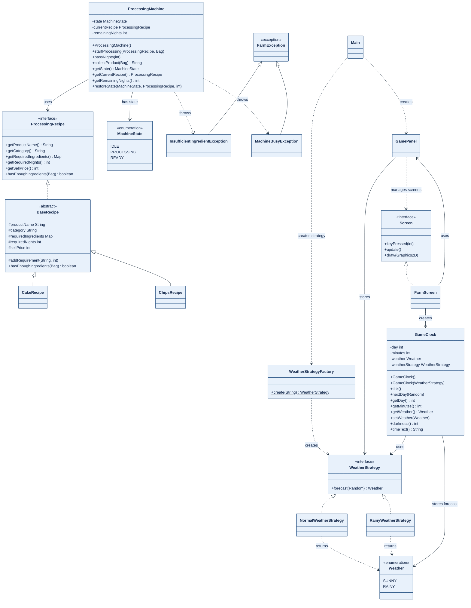

# Class Diagram

แผนภาพแสดงโครงสร้างคลาสและความสัมพันธ์ของระบบที่เพิ่มเข้ามาในการ Refactoring ของ Little Farm

## Explanation

### 1. Recipe System
- `ProcessingRecipe` เป็น Interface กำหนดเมธอดที่สูตรแปรรูปต้องมี
- `BaseRecipe` เป็น Abstract Class ที่ implements `ProcessingRecipe`
- `CakeRecipe` และ `ChipsRecipe` สืบทอดจาก `BaseRecipe`

### 2. Processing Machine System
- `ProcessingMachine` จัดการการเริ่มผลิต การนับคืน และการรับสินค้า
- `MachineState` กำหนดสถานะ IDLE, PROCESSING และ READY
- เครื่องแปรรูปใช้ `ProcessingRecipe` เพื่ออ่านข้อมูลสูตร
- `FarmException` เป็นคลาส Exception หลักของระบบ
- `InsufficientIngredientException` และ `MachineBusyException` เป็น Exception ที่สืบทอดจาก `FarmException`

### 3. Weather Strategy System
- `WeatherStrategy` เป็น Interface สำหรับกำหนดรูปแบบการสุ่มสภาพอากาศ
- `NormalWeatherStrategy` และ `RainyWeatherStrategy` เป็น Strategy ที่มีเงื่อนไขการสุ่มต่างกัน
- `WeatherStrategyFactory` สร้าง Strategy ตามโหมดที่เลือก
- `Main` ส่ง Strategy ไปยัง `GamePanel`
- `FarmScreen` สร้าง `GameClock` โดยส่ง Strategy จาก `GamePanel`
- `GameClock` ใช้ Strategy เพื่อสุ่มสภาพอากาศของวันถัดไป

### 4. Screen System
- `Screen` เป็น Interface กำหนดโครงสร้างพื้นฐานของหน้าจอเกม
- `FarmScreen` implements `Screen`
- `GamePanel` จัดการหน้าจอเกมและเปลี่ยนหน้าจอตามสถานะของเกม

## Existing Classes Modified During Refactoring

คลาสเดิมที่มีการแก้ไขเพื่อรองรับโครงสร้างใหม่ของระบบ มีทั้งหมด 4 คลาส

| Class | Modification |
|---|---|
| `FarmScreen` | ปรับการสร้าง GameClock ให้รับ WeatherStrategy จาก GamePanel |
| `GameClock` | เพิ่ม Constructor ที่รับ WeatherStrategy และใช้ Strategy ในการสุ่มอากาศของวันถัดไป |
| `GamePanel` | เพิ่มการจัดเก็บ WeatherStrategy และ Getter สำหรับส่ง Strategy ให้ส่วนอื่นใช้งาน |
| `Main` | เพิ่มการเลือก WeatherStrategy ผ่าน WeatherStrategyFactory ก่อนสร้าง GamePanel |
